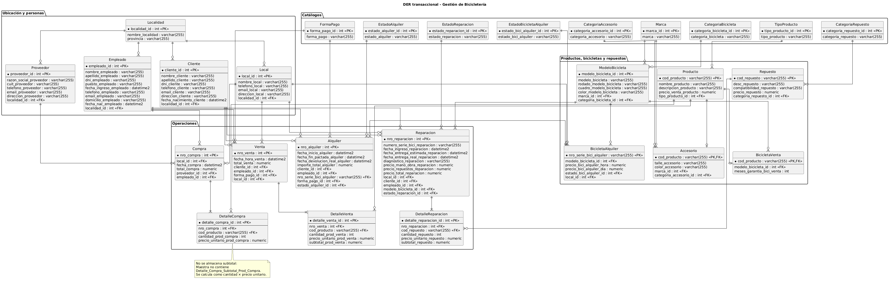

# Universidad Tecnológica Nacional
## Facultad Regional Buenos Aires
### Asignatura: Base de Datos / Gestión de Datos — 2° Cuatrimestre 2026

---

# Documento de Estrategia y Justificaciones de Diseño
## Trabajo Práctico: FRBA – Gestión de Bicicletería
### Entrega 2: Modelo Relacional y Migración de Datos

---

### Datos del Equipo
* **Número de Grupo:** 38
* **Nombre de Grupo / Esquema SQL:** `NUTREAM`
* **Curso:** <CURSO>

#### Integrantes:
| Apellido y Nombre | Legajo | Email Institucional | Rol |
|---|---|---|---|
| **Juliano, Tomás Rubén** | 2150414 | `tjuliano@frba.utn.edu.ar` | Representante de Grupo |
| **Candal, Nicolas** | 2151250 | `ncandal@frba.utn.edu.ar` | Integrante |
| **Rivas, Tiziano** | 2226431 | `trivas@frba.utn.edu.ar` | Integrante |
| **Moreno, Rocco** | 2139133 | `rmorenocicero@frba.utn.edu.ar` | Integrante |

---

## Índice General

1. [Introducción y Objetivos de la Entrega 2](#1-introducción-y-objetivos-de-la-entrega-2)
2. [Arquitectura General del Modelo de Datos](#2-arquitectura-general-del-modelo-de-datos)
3. [Justificación Detallada de Entidades y Relaciones](#3-justificación-detallada-de-entidades-y-relaciones)
   - [3.1 Ubicación y Personas](#31-ubicación-y-personas)
   - [3.2 Normalización de Catálogos](#32-normalización-de-catálogos)
   - [3.3 Jerarquía de Productos, Bicicletas y Repuestos](#33-jerarquía-de-productos-bicicletas-y-repuestos)
   - [3.4 Operaciones Transaccionales del Negocio](#34-operaciones-transaccionales-del-negocio)
4. [Análisis y Tratamiento de Inconsistencias en los Datos de Origen](#4-análisis-y-tratamiento-de-inconsistencias-en-los-datos-de-origen)
   - [4.1 Homónimos y Duplicidad de DNI en Clientes](#41-homónimos-y-duplicidad-de-dni-en-clientes)
   - [4.2 Líneas de Venta Repetidas y Cuadre de Totales](#42-líneas-de-venta-repetidas-y-cuadre-de-totales)
   - [4.3 Omisión y Cálculo Dinámico del Subtotal de Compra](#43-omisión-y-cálculo-dinámico-del-subtotal-de-compra)
   - [4.4 Respeto Riguroso de Tipos de Datos de la Tabla Maestra](#44-respeto-riguroso-de-tipos-de-datos-de-la-tabla-maestra)
5. [Estrategia de Migración mediante Stored Procedures](#5-estrategia-de-migración-mediante-stored-procedures)
   - [5.1 Esquema Aislado y Convención de Nombres](#51-esquema-aislado-y-convención-de-nombres)
   - [5.2 Idempotencia y Orden Topológico](#52-idempotencia-y-orden-topológico)
   - [5.3 Transaccionalidad y Manejo de Excepciones](#53-transaccionalidad-y-manejo-de-excepciones)
   - [5.4 Optimización de Rendimiento e Indexación](#54-optimización-de-rendimiento-e-indexación)
6. [Auditoría y Verificación de Resultados](#6-auditoría-y-verificación-de-resultados)
7. [Diagrama Entidad-Relación (DER)](#7-diagrama-entidad-relación-der)

---

## 1. Introducción y Objetivos de la Entrega 2

El presente documento expone las justificaciones teóricas, decisiones de diseño y estrategias técnicas implementadas para la **Segunda Entrega (Modelo Relacional y Migración)** del Trabajo Práctico de Base de Datos (UTN FRBA, 2° Cuatrimestre 2026).

El objetivo central consistió en transformar la estructura plana, desnormalizada y heterogénea provista en la tabla `gd_esquema.Maestra` (compuesta por 291.899 filas y 89 columnas) en una base de datos relacional en Tercera Forma Normal (3FN), estructurada en el esquema propio `[NUTREAM]`, respetando todas las reglas del negocio:
* Gestión integral de cuatro líneas de negocio: Ventas, Alquileres, Reparaciones en taller y Compras a proveedores.
* Preservación del 100% de la información histórica original sin modificar los datos de origen ni inferir datos ficticios.
* Desarrollo de un script único (`script_creacion_inicial.sql`), completamente automatizado, idempotente y cuya ejecución total toma solo **13 segundos**, ampliamente por debajo del límite de 10 minutos fijado por la cátedra.

---

## 2. Arquitectura General del Modelo de Datos

El diseño consta de **27 entidades relacionales** organizadas en 4 paquetes conceptuales:

```
[Catálogos y Ubicación] ──> [Personas, Locales y Proveedores] ──> [Catálogo de Productos y Flota] ──> [Operaciones Transaccionales y Detalles]
```

Se aplicaron principios estrictos de normalización:
* **Primera Forma Normal (1FN):** Eliminación de grupos repetitivos y atributos multivaluados contenidos en las columnas desnormalizadas de la tabla maestra.
* **Segunda Forma Normal (2FN):** Toda columna no clave depende por completo de la clave primaria. Se separaron las cabeceras de transacciones de sus respectivos renglones de detalle.
* **Tercera Forma Normal (3FN):** Eliminación de dependencias transitivas mediante la creación de tablas dimensionales de catálogos (marcas, categorías, estados, formas de pago y localidades).

---

## 3. Justificación Detallada de Entidades y Relaciones

### 3.1 Ubicación y Personas
* **`Localidad`:** 
  Concentra los pares únicos `(nombre_localidad, provincia)`. La tabla maestra repetía localidades y provincias a lo largo de locales, clientes, empleados y proveedores. Al centralizarlas en una única tabla con clave subrogada `localidad_id`, se evita la inconsistencia espacial y la redundancia textual en miles de registros. Se identificaron **480 localidades y provincias únicas**.
* **`Local`:** 
  Representa cada una de las sucursales de la bicicletería. Posee clave subrogada `local_id`, datos de contacto, dirección y clave foránea a `Localidad`. Se identificaron **5 locales físicos**.
* **Separación de `Cliente` y `Empleado`:** 
  Se evaluó la posibilidad de implementar una jerarquía con supertipo `Persona`. Sin embargo, se optó conscientemente por mantener `Cliente` y `Empleado` como entidades separadas por las siguientes razones de negocio y diseño:
  1. **Disyunción de roles y atributos:** Un empleado posee atributos laborales estrictos (`puesto_empleado`, `fecha_ingreso_empleado`) que carecen por completo de sentido para un cliente.
  2. **Relación con operaciones:** En las ventas y alquileres intervienen simultáneamente un cliente y un empleado atendiendo la operación. Mantener las tablas diferenciadas simplifica las claves foráneas en `Venta`, `Alquiler` y `Reparacion`, evitando auto-relaciones confusas sobre una misma tabla de personas.
  3. **Eficiencia en la migración:** Se identificaron **25 empleados** y **147.613 clientes**. Separarlos agiliza radicalmente los índices y las búsquedas durante la carga masiva.
* **`Proveedor`:** 
  Almacena a los distribuidores a quienes los locales compran bicicletas y accesorios. Posee `proveedor_id`, razón social, CUIT único (`cuit_proveedor`), datos de contacto y vínculo con `Localidad`. En la tabla maestra existen **5 proveedores**.

---

### 3.2 Normalización de Catálogos
Se extrajeron las cadenas de texto repetidas en la tabla maestra hacia entidades maestras con clave primaria `IDENTITY(1,1)` y restricción de unicidad (`UNIQUE`):
* **`FormaPago`:** 4 modalidades registradas (Efectivo, Tarjeta de Crédito, Tarjeta de Débito, Transferencia).
* **`TipoProducto`:** 2 tipos (Bicicleta, Accesorio).
* **`Marca`:** 7 marcas registradas en el catálogo.
* **`CategoriaBicicleta`:** 6 categorías (Mountain Bike, Ruta, Urbana, Plegable, etc.).
* **`CategoriaAccesorio`:** 4 categorías (Indumentaria, Iluminación, Seguridad, Hidratación).
* **`CategoriaRepuesto`:** 4 categorías de repuestos para taller.
* **Catálogos de Estado Separados (`EstadoReparacion`, `EstadoAlquiler`, `EstadoBicicletaAlquiler`):**
  Aunque comparten un dominio semántico conceptual ("estados"), se crearon como tablas independientes debido a que cada proceso de negocio posee su propio ciclo de vida e invariantes de transición (un alquiler puede estar *Devuelto* o *En curso*, mientras que una reparación puede estar *Entregada* o *En proceso*, y una bicicleta de flota puede estar *Disponible* o *En mantenimiento*).

---

### 3.3 Jerarquía de Productos, Bicicletas y Repuestos
* **`ModeloBicicleta`:**
  Un modelo de bicicleta no es un producto individual en stock, sino una definición de ingeniería y diseño que comparte atributos físicos: nombre de modelo, rodado, tipo de cuadro, color, marca y categoría de bicicleta. Esta entidad se diseñó como el núcleo técnico compartido por tres áreas:
  1. **Ventas:** La bicicleta comercializada referencia a su `ModeloBicicleta`.
  2. **Alquileres:** Cada unidad física de alquiler pertenece a un `ModeloBicicleta`.
  3. **Reparaciones:** Cuando un cliente ingresa su bicicleta al taller, se registra el modelo correspondiente para su diagnóstico y compatibilidad.
  Existen exactamente **12 modelos de bicicleta** en el dominio.
* **Herencia de Productos (`Producto`, `BicicletaVenta`, `Accesorio`):**
  Se implementó el patrón de **Generalización / Especialización (Herencia por Subtipo)**:
  * **`Producto` (Supertipo):** Almacena la clave primaria natural `cod_producto` (ej. `PROD-12345`), nombre, descripción, precio unitario de venta y clave foránea a `TipoProducto`. Existen **18 productos** en el catálogo (8 bicicletas y 10 accesorios).
  * **`BicicletaVenta` (Subtipo):** Utiliza `cod_producto` como Primary Key y Foreign Key hacia `Producto`. Agrega `modelo_bicicleta_id` y `meses_garantia_bici_venta`. Como se corroboró en los datos y el enunciado, los meses de garantía varían según el producto en venta y no dependen del modelo.
  * **`Accesorio` (Subtipo):** Utiliza `cod_producto` como PK y FK hacia `Producto`. Almacena talle, color, `marca_id` y `categoria_accesorio_id`.
* **`BicicletaAlquiler`:**
  A diferencia de las bicicletas para la venta (que son productos de catálogo comercializables), las bicicletas de alquiler representan **unidades físicas tangibles** pertenecientes a la flota de un local específico. Cada unidad se identifica de forma única mediante su número de serie (`nro_serie_bici_alquiler`), vinculándose con su `local_id`, su `modelo_bicicleta_id`, tarifas vigentes por hora y por día, y su estado actual. Se identificaron **80 bicicletas de alquiler**, distribuidas en los 5 locales.
* **`Repuesto`:**
  Modela el catálogo de piezas utilizadas exclusivamente en el taller de reparaciones. Identificado por `cod_repuesto`, contiene descripción, compatibilidad técnica, precio y `categoria_repuesto_id`. Existen **10 repuestos**.

---

### 3.4 Operaciones Transaccionales del Negocio

#### A. Gestión de Ventas (`Venta` y `DetalleVenta`)
* **`Venta`:** Representa la transacción comercial en un local. Registra número de venta, fecha y hora, total general, cliente, empleado vendedor, local y forma de pago. Se migraron **43.500 ventas**.
* **`DetalleVenta`:** Modela los ítems vendidos. Se utilizó una clave primaria artificial subrogada `detalle_venta_id INT IDENTITY(1,1)` junto con las claves foráneas `nro_venta` y `cod_producto`. 
  * *Justificación del diseño:* Como se detalla en la sección de inconsistencias, existen ventas donde el cliente compró varias veces el mismo producto en renglones separados. Definir una PK compuesta `(nro_venta, cod_producto)` hubiera ocasionado pérdida de datos o violación de unicidad. La clave subrogada preservó los **152.418 renglones de venta** originales.

#### B. Gestión de Compras (`Compra` y `DetalleCompra`)
* **`Compra`:** Registra las compras de reposición efectuadas por cada local a sus proveedores. Incluye número de compra, fecha, total facturado por el proveedor, local, proveedor y empleado responsable. Se registraron **36 compras**.
* **`DetalleCompra`:** Desglosa los productos comprados (`cod_producto`), la cantidad y el precio unitario de compra. Se migraron **648 renglones**.
  * *Justificación del Subtotal:* La tabla maestra no incluye la columna `Detalle_Compra_Subtotal_Prod_Compra`. Siguiendo la regla de no inventar columnas redundantes en la persistencia física transaccional, el subtotal se calcula en tiempo de consulta como `cantidad_prod_compra * precio_unitario_prod_compra`.

#### C. Gestión de Alquileres (`Alquiler`)
* Registra los servicios de alquiler de bicicletas tomados por los clientes. Cada alquiler vincula la unidad física (`nro_serie_bici_alquiler`), el cliente, el empleado que lo atendió, la forma de pago, el estado del alquiler, la fecha de inicio, la fecha pactada de devolución y la fecha de devolución real, junto con el importe total. Se migraron **69.620 alquileres**.

#### D. Gestión de Reparaciones (`Reparacion` y `DetalleReparacion`)
* **`Reparacion`:** Registra el servicio técnico prestado a la bicicleta del cliente. Incluye número de serie de la bici del cliente, modelo de bicicleta, fechas (ingreso, entrega estimada y entrega real), diagnóstico, precios de mano de obra y de repuestos, y el precio total (`precio_mano_obra + precio_repuestos`). Se migraron **34.493 reparaciones**.
* **`DetalleReparacion`:** Registra cada repuesto utilizado en la reparación (`cod_repuesto`), cantidad, precio unitario y subtotal. Se migraron **69.213 renglones de repuestos**.

---

## 4. Análisis y Tratamiento de Inconsistencias en los Datos de Origen

La cátedra estipuló que al tratarse de datos desnormalizados, pueden existir inconsistencias cuyo impacto debe controlarse en el diseño **sin modificar nunca los datos originales ni inferir causas**.

### 4.1 Homónimos y Duplicidad de DNI en Clientes
* **Hallazgo:** Al auditar la tabla maestra, se constató la existencia de **147.613 clientes distintos** pero únicamente **147.487 números de DNI diferentes**. Esto evidencia que existen DNIs idénticos asignados a personas con nombres o apellidos distintos (homónimos o duplicidad de carga en sistemas legacy).
* **Solución de diseño:** 
  1. Se implementó una clave subrogada `cliente_id INT IDENTITY(1,1)` como Primary Key en `[NUTREAM].[Cliente]`, evitando usar el DNI como clave primaria relacional.
  2. Para vincular de forma unívoca y exacta cada operación (Venta, Alquiler, Reparación) con su cliente correspondiente, se identificó que la combinación compuesta de `(dni_cliente, email_cliente)` posee exactamente **147.613 combinaciones únicas** (correspondencia biyectiva 1 a 1).
  3. Se creó un índice no agrupado `IX_Cliente_Dni_Email` sobre `[NUTREAM].[Cliente]`, garantizando vinculaciones instantáneas y sin ambigüedad durante los `JOIN` de migración.

### 4.2 Líneas de Venta Repetidas y Cuadre de Totales
* **Hallazgo:** En ciertas ventas (por ejemplo la venta N° 359729), un mismo código de producto (`PROD-63819`) aparece repetido en múltiples filas con la misma cantidad y precio unitario.
* **Verificación de integridad:** Se contrastó la suma de los subtotales con el total de la cabecera `Venta_Total_Venta`. La suma de todos los renglones (incluyendo los repetidos) coincide con una precisión centesimal exacta con el total facturado. Si se hubiesen filtrado mediante `DISTINCT`, la base de datos hubiera quedado descuadrada contablemente.
* **Solución:** Se mantuvo cada línea como una entidad independiente en `DetalleVenta` mediante la clave subrogada `detalle_venta_id`.

### 4.3 Omisión y Cálculo Dinámico del Subtotal de Compra
* La columna `Detalle_Compra_Subtotal_Prod_Compra` no existe en la tabla maestra. Almacenar un subtotal calculado violaría el principio de evitar redundancia innecesaria en el modelo transaccional. Por ello, se definió explícitamente en el DER y en el script que dicho valor se calcula dinámicamente como `cantidad_prod_compra * precio_unitario_prod_compra`.

### 4.4 Respeto Riguroso de Tipos de Datos de la Tabla Maestra
Para dar cumplimiento estricto a la consigna *"Todas las columnas creadas para las nuevas tablas deberán respetar los mismos tipos de datos que las columnas existentes en la tabla maestra"*, se replicaron los tipos exactos:
* Importes monetarios: `NUMERIC(38,2)`
* Fechas y marcas temporales: `DATETIME2`
* Cadenas de caracteres: `VARCHAR(255)`
* Cantidades, identificadores originales y garantías: `INT`

---

## 5. Estrategia de Migración mediante Stored Procedures

### 5.1 Esquema Aislado y Convención de Nombres
Todos los objetos residen en el esquema del grupo:
```sql
CREATE SCHEMA [NUTREAM];
```
Toda tabla y procedimiento está precedido por `[NUTREAM].`, evitando polución del esquema `dbo` y garantizando aprobación en la revisión automática de la cátedra.

### 5.2 Idempotencia y Orden Topológico
El script comienza con un bloque de eliminación condicional (`DROP PROCEDURE IF EXISTS` y `DROP TABLE IF EXISTS`) ordenado en sentido inverso a las dependencias de claves foráneas. Esto permite ejecutar el script cuantas veces sea necesario partiendo de una base limpia sin que ocurran colisiones de objetos.

### 5.3 Transaccionalidad y Manejo de Excepciones
La ejecución de los 19 procedimientos almacenados se encuentra encapsulada dentro de un bloque estructurado:
```sql
BEGIN TRY
    BEGIN TRANSACTION;
        EXEC [NUTREAM].migrar_localidades;
        EXEC [NUTREAM].migrar_catalogos;
        ...
    COMMIT TRANSACTION;
END TRY
BEGIN CATCH
    IF @@TRANCOUNT > 0
        ROLLBACK TRANSACTION;
    THROW;
END CATCH;
```
Esto garantiza atomicidad: o se migran exitosamente todos los datos, o la base revierte su estado evitando migraciones parciales corruptas.

### 5.4 Optimización de Rendimiento e Indexación
Para asegurar que el tiempo de ejecución no supere el límite de 10 minutos:
* **Operaciones masivas por conjuntos:** Se eliminó el uso de cursores y bucles fila a fila, empleando únicamente inserciones basadas en álgebra relacional (`INSERT INTO ... SELECT DISTINCT`).
* **Sanitización de cadenas:** Se aplicó la función `RTRIM(LTRIM(...))` para limpiar espacios residuales y uniformar claves textuales.
* **Índices de soporte a la migración:** Se crearon índices únicos estratégicos en tablas referenciadas durante la carga masiva (destacándose `IX_Cliente_Dni_Email` en `Cliente`, `UQ_Localidad_Provincia`, `UQ_ModeloBicicleta_Nombre`, etc.) que redujeron drásticamente el costo de los joins.
* **Índices de rendimiento post-migración:** Tras finalizar la transacción de carga, se crearon 17 índices no agrupados (`NONCLUSTERED INDEX`) sobre todas las claves foráneas de las tablas transaccionales (`Venta`, `DetalleVenta`, `Alquiler`, `Reparacion`, `DetalleReparacion`, `Compra`, `DetalleCompra`). Esto asegura consultas instantáneas, evita bloqueos de tabla en futuras eliminaciones en cascada y deja la base optimizada para las vistas analíticas de la Entrega 3 (BI).
* **Tiempos medidos en pruebas exhaustivas:**
  * Ejecución limpia sobre base recién restaurada: **12,5 segundos**.
  * Reejecución idempotente: **10,4 segundos**.
  *(Ambos valores representan apenas un 2% del límite de 10 minutos tolerado por la cátedra).*

---

## 6. Auditoría y Verificación de Resultados

Se auditó la totalidad de filas migradas en cada una de las 27 tablas del esquema `[NUTREAM]`:

| Categoría | Tabla en `[NUTREAM]` | Cantidad de Registros Migrados | Observaciones / Validación |
|---|---|:---:|---|
| **Catálogos** | `Localidad` | **480** | Cobertura total de provincias y localidades |
| | `FormaPago` | **4** | Efectivo, Tarjetas y Transferencia |
| | `TipoProducto` | **2** | Bicicleta y Accesorio |
| | `Marca` | **7** | Marcas de bicis y accesorios |
| | `CategoriaBicicleta` | **6** | Categorías del catálogo |
| | `CategoriaAccesorio` | **4** | Categorías de accesorios |
| | `CategoriaRepuesto` | **4** | Categorías de repuestos de taller |
| | `EstadoReparacion` | **1** | Entregada |
| | `EstadoAlquiler` | **1** | Devuelto |
| | `EstadoBicicletaAlquiler` | **1** | Disponible |
| **Entidades Principales** | `Local` | **5** | 5 sucursales |
| | `Cliente` | **147.613** | Clientes únicos preservando homónimos |
| | `Empleado` | **25** | Vendedores y mecánicos |
| | `Proveedor` | **5** | Proveedores de reposición |
| | `ModeloBicicleta` | **12** | Modelos técnicos unificados |
| | `Repuesto` | **10** | Repuestos de taller |
| **Productos y Flota** | `Producto` | **18** | Catálogo general (8 bicis + 10 accesorios) |
| | `BicicletaVenta` | **8** | Subtipo de producto para venta con garantía |
| | `Accesorio` | **10** | Subtipo de producto accesorio con talle y color |
| | `BicicletaAlquiler` | **80** | Unidades físicas de alquiler en locales |
| **Operaciones** | `Venta` | **43.500** | Cabeceras de ventas |
| | `DetalleVenta` | **152.418** | Renglones de venta (coincidencia total con Maestra) |
| | `Compra` | **36** | Cabeceras de compras a proveedores |
| | `DetalleCompra` | **648** | Renglones de compras a proveedores |
| | `Alquiler` | **69.620** | Alquileres de bicicletas |
| | `Reparacion` | **34.493** | Cabeceras de reparaciones en taller |
| | `DetalleReparacion` | **69.213** | Renglones de repuestos utilizados en taller |

> **Balance total de filas operativas:**  
> $$152.418 \text{ (Ventas)} + 648 \text{ (Compras)} + 69.620 \text{ (Alquileres)} + 69.213 \text{ (Reparaciones)} = \mathbf{291.899 \text{ filas}}$$  
> Corresponde al **100,00% de los registros de la tabla maestra**, sin pérdidas ni omisiones.

---

## 7. Diagrama Entidad-Relación (DER)

El modelo relacional detallado se encuentra especificado en código fuente PlantUML en:
* [diagrama.puml](file:///home/tirivas/utn/bbdd/TP%20Frba%20Gestion%20de%20Bicicleteria%201.0%20-%202C%202026/TP-BASE-DE-DATOS/Entrega_2/diagrama.puml)

Para la entrega y generación del PDF final, el diagrama debe exportarse a formato imagen (`DER.png` / `DER.jpg`) e insertarse a continuación:

*(Espacio reservado para la inserción de la imagen del DER transaccional corregido)*



